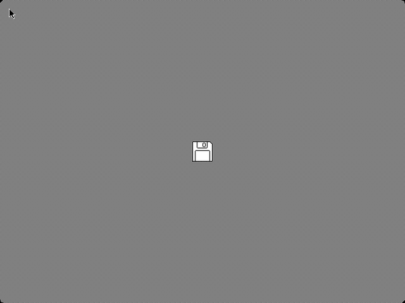
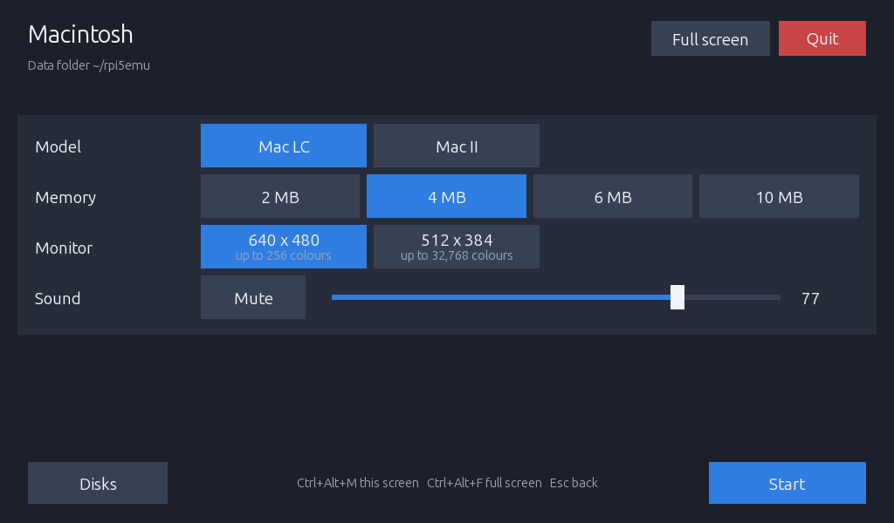
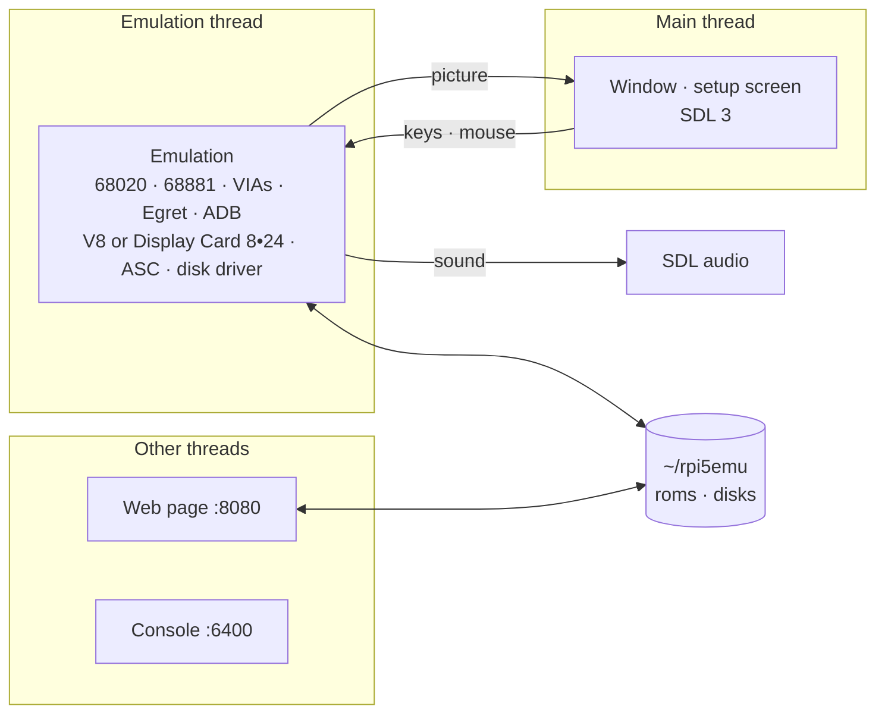

<h1 align="center">rpi5mac2</h1>

<p align="center">
  <b>A colour Macintosh LC or Macintosh II on the Raspberry Pi 5, in a window of its own.</b><br>
  68020 (and the II's 68881), 640×480 in 256 colours, up to 10 MB, System 7.5.5, disk images of any size in three drives.
</p>

<p align="center">
  
  
  
  
  
  
</p>

<p align="center">
  <b>Work in progress:</b> not everything has been tested, and games and demos may or may not
  work satisfactorily.
</p>

<p align="center">
  
  <br>
  <sub>The Mac II (with its Display Card 8•24) asking for a system disk, on the Pi.</sub>
</p>

rpi5mac2 runs [esp32mac2](https://github.com/rlucencic/esp32mac2)'s Mac on a Raspberry Pi 5 with
64-bit Linux, in a window of its own (X11 or Wayland, through SDL 3). The machine is the
same code as on the ESP32 boards: esp32mac2's platform-independent core and
[esp32emu](https://github.com/rlucencic/esp32emu)'s CPU core, on
[rpi5emu](https://github.com/rlucencic/rpi5emu), the family's Linux runtime: a setup
screen in the window, sound, the Pi's keyboard and mouse, a web page on your network and a
console.

It's one of the rpi5 family, the Raspberry Pi versions of the esp32 emulators:
[rpi5zx](https://github.com/rlucencic/rpi5zx) (ZX Spectrum),
[rpi5cpc](https://github.com/rlucencic/rpi5cpc) (Amstrad CPC),
[rpi5cbm](https://github.com/rlucencic/rpi5cbm) (Commodore 64 and 128),
[rpi5coco](https://github.com/rlucencic/rpi5coco) (Tandy Color Computer 2 and 3),
[rpi5gs](https://github.com/rlucencic/rpi5gs) (Apple IIGS),
[rpi5msx](https://github.com/rlucencic/rpi5msx) (MSX1 and MSX2),
[rpi5xl](https://github.com/rlucencic/rpi5xl) (Atari 800XL and 130XE),
[rpi5ste](https://github.com/rlucencic/rpi5ste) (Atari STE),
[rpi5pc](https://github.com/rlucencic/rpi5pc) (IBM PC/XT and PC/AT),
[rpi5mac](https://github.com/rlucencic/rpi5mac) (Macintosh Plus, SE, Classic),
[rpi5mac3](https://github.com/rlucencic/rpi5mac3) (Macintosh LC II and LC III),
[rpi5arc](https://github.com/rlucencic/rpi5arc) (Acorn Archimedes),
[rpi5ami](https://github.com/rlucencic/rpi5ami) (Amiga 500, 2000, 600, 1200).

## Features

**The machines**
- **68020** at 15.67 MHz ([Musashi](https://github.com/kstenerud/Musashi)
  core), at full speed on the Pi
- **Macintosh LC**: 2, 4, 6 or 10 MB (the board's 2 MB and a SIMM pair);
  the V8's built-in video at 640×480 in black and white up to 256 colours,
  or 512×384 up to thousands (32,768); Egret for the ADB keyboard and mouse, the
  clock and parameter RAM; the V8's Apple Sound Chip; no FPU, as a stock LC
- **Macintosh II**: 2, 4 or 8 MB; a **68881** FPU; two VIAs (ADB, the clock,
  the slot interrupts); the original Apple Sound Chip with its four-voice
  wavetable (the II's startup chord); NuBus with the **Macintosh Display
  Card 8•24** in slot $9, found and driven by its own ROM (black and white
  up to 256 colours)
- A 13-inch (640×480) or 12-inch (512×384) monitor, chosen on the setup
  screen, whose buttons say how many colours each one gets on the model
  (LC: up to 256 or 32,768; II: up to 256 on both); 256 colours by default
  on both
- The startup chime, system beeps and sound through the Apple Sound Chip,
  through the Pi's sound output
- The clock is set from the Pi's time; each model's parameter RAM (the
  control panels' settings) is kept across power-offs

**Disks**
- **Three drives** for disk images of any size, floppies and hard disks
  alike, through a fast replacement of the Mac's disk driver (from esp32mac)
- System 7.5.5 tested on both machines; Mac OS 7.6.1 starts on the LC too
  ([esp32mac3](https://github.com/rlucencic/esp32mac3) is made for it)
- Raw images (`.dsk`, `.img`, `.hfv`), Disk Copy 4.2 images (`.image`),
  partitioned hard disk images (`.hda`), CD images (`.iso`, `.toast`,
  locked as CDs are) and uncompressed `.dmg` images (read-only)
- **Mac archives straight from the old download sites**: StuffIt (`.sit`,
  `.sea`), Compact Pro (`.cpt`), BinHex (`.hqx`) and MacBinary (`.bin`)
  files dropped on the web page are unpacked in your browser and put on a
  disk image of their own, ready to insert
- **New blank disks** from the web page (800 KB and 1.4 MB floppies, 20,
  100 or 500 MB hard disks) or the setup screen (800 KB); the Mac offers to
  initialise them
- Disks inserted while the Mac runs appear on the desktop; ejecting one on
  the Mac frees the drive

**Around it**
- **A window** of its own on the Pi's desktop (X11 or Wayland), resizable, full screen
  with Ctrl+Alt+F; the picture in the machine's shape, smoothly scaled
- **Setup screen** in the window, first thing at start and any time with Ctrl+Alt+M:
  model, memory, monitor, the sound's volume, the drives and their images (insert, eject, new
  blank ones), Start / Back / Restart, Reset
- **The Pi's keyboard and mouse**: keys by position, as the boards' Bluetooth keyboards;
  a click in the window gives the mouse to the machine, Ctrl+Alt+G takes it back
- **Web page** at `http://<the Pi>:8080/`: drop images (or ZIP files) onto it, insert
  them, make blank ones, and watch the machine and its drives live
- **Sound** through SDL (PipeWire, PulseAudio or ALSA), the machine paced by the clock
- **Console** on the terminal and on `127.0.0.1:6400`: keys, typing, drives, screenshots

<p align="center">
  
  <br><sub>The setup screen in the window, before the Mac starts</sub>
</p>

## Getting started

### 1. What you need

- A Raspberry Pi 5 with 64-bit Linux (developed on Ubuntu 26.04; any Linux with SDL 3.2 or
  later should do)
- The tools and libraries:
  `sudo apt install build-essential cmake ninja-build pkg-config libsdl3-dev libsdl3-ttf-dev libpng-dev`
- [esp32emu](https://github.com/rlucencic/esp32emu), [rpi5emu](https://github.com/rlucencic/rpi5emu)
  and [esp32mac2](https://github.com/rlucencic/esp32mac2), cloned next to this project
- The ROMs (below)

### 2. Build

```sh
git clone https://github.com/rlucencic/esp32emu.git
git clone https://github.com/rlucencic/rpi5emu.git
git clone https://github.com/rlucencic/esp32mac2.git
git clone https://github.com/rlucencic/rpi5mac2.git && cd rpi5mac2
cmake -S . -B build -G Ninja && cmake --build build
```

### 3. ROMs

The LC's (512 KB) or the II's (256 KB) and, for the II, the Display Card
8•24's declaration ROM (341-0868), in the data folder's `roms/`
(`~/rpi5emu/roms`), under any name (esp32mac2's: `lc.rom`, `ii.rom`,
`mdc824.rom`): they're found by their contents. Not part of this
repository.

### 4. First start

1. `build/rpi5mac2`: the setup screen opens in a window.
2. Choose the model and click **Start**.
3. Put images into `~/rpi5emu/disks/`, drop them on the window or the web page, and
   insert them on the setup screen's **Disks** page.

## Using it

| To | Do |
|---|---|
| Get back to the setup screen | Ctrl+Alt+M (the machine waits meanwhile) |
| Full screen | Ctrl+Alt+F |
| Give the mouse to the machine, take it back | A click in the window; Ctrl+Alt+G |
| Run as fast as it goes (warp) | Ctrl+Alt+W, again for real speed |
| Take a screenshot | Ctrl+Alt+S (into `~/rpi5emu/screenshots`), or the console's `s` |
| Insert an image | The setup screen's **Disks** page, drop it on the window or the web page, or name it on the command line: `build/rpi5mac2 System755.hda` |
| Start straight into the machine | `build/rpi5mac2 -S`, with the setup screen's rows as `--choice`: `build/rpi5mac2 -S --choice "Model=Mac II"` |
| Show the window on another computer | Log in with `ssh -C -Y <the Pi>` and start it there: fine for still pictures; games want the Pi's own monitor |

Images live in `~/rpi5emu/disks/`, settings in `~/.config/rpi5emu/settings.ini`; the
inserted images are remembered across starts. `build/rpi5mac2 --help` lists the options.

**Keyboard**: by position, as on Apple's Extended Keyboard (US). Command is
the Windows/⌘ key, Option is Alt, Control is Ctrl; Backspace is Delete,
Delete is the forward delete, Insert is Help, Num Lock is Clear; F1-F15,
Home, End, Page Up and Page Down and the keypad as themselves.

## How it works



- **[esp32mac2](https://github.com/rlucencic/esp32mac2)'s `components/mac2`**: the Mac,
  platform independent: the same code runs on the ESP32 boards.
- **`src/`**: the glue, esp32mac2's `main/main.c` ported: memory, ROMs, settings, keyboard map,
  drives and status.
- **[rpi5emu](https://github.com/rlucencic/rpi5emu)**: the window, the setup screen, sound,
  input, the web page, the console, the data folder and the settings.
- **[esp32emu](https://github.com/rlucencic/esp32emu)**: the CPU core (Musashi 68020).

## Development

```sh
../rpi5emu/tools/pi.sh rpi5mac2 build        # from another computer: sync to the Pi, build there
../rpi5emu/tools/pi.sh rpi5mac2 run          # its window on this computer (ssh -C -Y)
../rpi5emu/tools/pi.sh rpi5mac2 headless     # no window: drive it through the console
../rpi5emu/tools/console.sh i 's /tmp/shot.png'
```

`CLAUDE.md` has the details: the layout, how it was ported, the checks; esp32mac2's own
`CLAUDE.md` has the machine's.

## Limitations

- Checked on the Pi through its console and screenshots: the LC and the II at full speed to their disk icon. Not yet by hand
  in the window, with the sound heard, or with much software.
- Over X forwarding (`ssh -Y`) every changed picture crosses the network: 8 to 15 a second.
- The CPU's pace is an estimate: each 68020 cycle is counted twice, for a
  16-bit path to memory; it hasn't been calibrated against a real LC or II.
- No SCSI devices, serial ports, AppleTalk, printer, PDS cards or other
  NuBus cards; no 68851 PMMU on the II, so no virtual memory there. The LC
  has no FPU (as a stock one).
- Millions of colours on the Mac II's card needs 32-bit addressing, which
  the original II only gets with an extension (MODE32). The packed RGB
  path is tested with injected guest code; the MODE32 software workflow
  remains untested.
- Only the Mac II's later ROM (checksum 9779D2C4) is recognised so far.
- The Mac's volume setting is ignored.
- Disk images are presented through the floppy driver: copy-protected
  originals that talk to the floppy hardware directly don't work.

## Credits

- [Musashi](https://github.com/kstenerud/Musashi) by Karl Stenerud (MIT
  licence), via Matt Evans' [fork](https://github.com/evansm7/Musashi) for
  embedded use
- [MAME](https://www.mamedev.org)'s Mac LC and Mac II drivers by R. Belmont
  (V8, pseudo-VIA, Ariel, ASC; hardware tests by Doug Brown) and the
  Display Card 4•8/8•24 by R. Belmont and Vas Crabb, the reference for how
  these machines' chips behave
- Linux's `via-cuda.c` and QEMU's Cuda, for the Egret packets
- [Mini vMac](https://www.gryphel.com/c/minivmac/) and Matt Evans'
  [umac](https://github.com/evansm7/umac), via esp32mac
- [The Unarchiver](https://theunarchiver.com)'s XADMaster by Dag Ågren (LGPL),
  the reference for the StuffIt and Compact Pro formats (via esp32mac)
- [SDL](https://libsdl.org) 3 for the window, the sound and the input

## Licence

[MIT](LICENSE).

Apple, Macintosh and Mac are trademarks of Apple Inc. This project contains
no Apple code; you need your own ROM images and system software.
